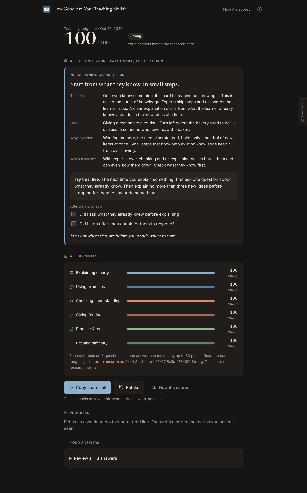
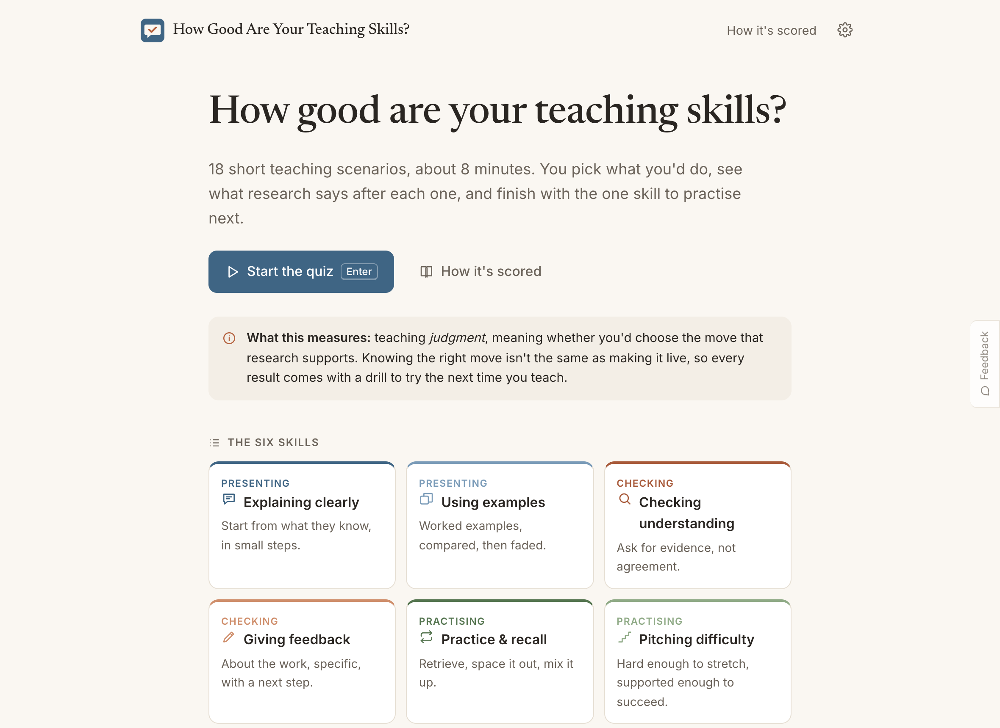
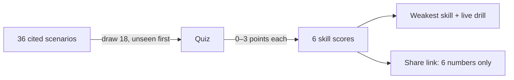

# How Good Are Your Teaching Skills?

You answer 18 short teaching scenarios in about 8 minutes. The result shows which of six teaching skills to practise next, and every answer cites the research behind it.

**[Take it →](https://amalmehta.github.io/HowGoodAreYourTeachingSkills/)**

| Pick a move, see the research | Your profile and one drill to practise |
|---|---|
|  |  |

| Home | Scoring, explained | On a phone |
|---|---|---|
|  |  |  |

It measures teaching **judgment** (knowing the right move), not performance, and it has had no psychometric validation. The site says so on the result and method pages.

- [Instructions](docs/INSTRUCTIONS.md): run, test, deploy
- [System design](docs/SYSTEM-DESIGN.md)
- [File structure](docs/FILE-STRUCTURE.md)
- [Manual review checklist](docs/REVIEW-CHECKLIST.md)
- [Prompt log](docs/PROMPTS.md)
