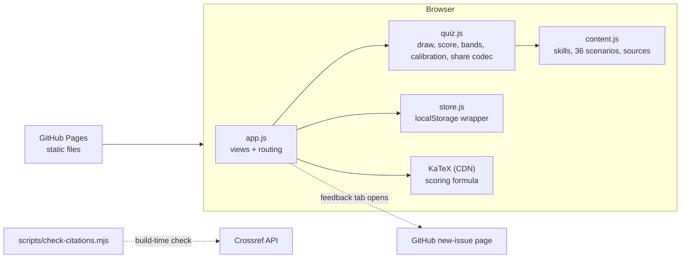

# System Design

How Good Are Your Teaching Skills? is a static website. It's for a mentor choosing one teaching skill to practise. You guess a band for each of 6 skills, answer 18 teaching scenarios, and get a profile, the gap between each guess and score (calibration), your weakest skill, and one drill to practise. There is no server code: everything runs in the visitor's browser.

## Architecture

| Piece | Job | Interface |
|---|---|---|
| `src/content.js` | All words the quiz says: skills, families, scenarios, options with points, explanations, drills, sources. Pure data. | `SKILLS`, `SCENARIOS`, `SOURCES` |
| `src/quiz.js` | Pure functions with no DOM or storage. Draws a run from the bank, scores it, assigns bands, picks the weakest skill, and encodes/decodes share links. | `drawRun(seen, rng)`, `scoreRun(run, answers)`, `band(score)`, `calibration(guesses, scores)`, `weakest(scores)`, `encodeShare`/`decodeShare` |
| `src/store.js` | Reads and writes localStorage. Every access is in try/catch, so a private window or blocked storage falls back to in-memory storage. | `load()`, `save(state)`, `clear()` |
| `src/app.js` | Renders views by hash route (`#/`, `#/quiz`, `#/result`, `#/r/<code>`, `#/method`). Handles keyboard shortcuts, settings and the feedback tab. | — |
| `assets/style.css` | Tokens for light and dark mode, plus layout. | CSS custom properties |

Each piece can be replaced on its own. For example, content could move to JSON, or storage could move to a server, without touching the other modules.

## Main flows

1. **Take the quiz.** On Home, Start calls `drawRun`, which picks 1 of 2 variants for each of the 18 slots and prefers variants not seen before.
   - **Guess step:** it opens on a self-guess screen (`inProgress.guessed === false`), with one band per skill. The person can skip, and the guess is saved as they go.
   - **Scenarios:** each scenario hides its skill label until it has been answered, so the guess can't steer the pick. Each answer shows the why and its source at once.
   - **Result:** after the 18th answer, `scoreRun` → the Result view, which shows `calibration(guesses, scores)` beside the skill bars. The run, including the guesses, is appended to history.
2. **Share.** `encodeShare(scores)` → `#/r/<6 numbers>`. The fragment after `#` is never sent to the server. Opening the link shows a read-only card with a "Take it yourself" button. Bad codes show a friendly error with the same button.
3. **Return visit.** Home shows the last result and a history line with each past overall score, labelled "rises partly reflect seeing questions before".

## Where data lives

- **localStorage key `hgats.v1`**: `{ seen: [scenarioIds], history: [{date, scores, overall, items, answers, guesses}], inProgress: {items, answers, index, guesses, guessed}, prefs, selfChecks }`. `guesses` maps skill id → band name, or null when skipped. Runs saved before the guess step have no `guessed` flag and continue straight to the scenarios. ``. A version prefix means a future schema can migrate or ignore old data.
- Nothing is sent anywhere. There are no analytics or cookies. The share link holds only 6 integers.
- No backups. Clearing site data wipes history, and the settings page says so.

## Key decisions and trade-offs

| Decision | Why | Cost |
|---|---|---|
| Scenario quiz (situational judgment test) over self-rating | Self-ratings track confidence, not skill. | Measures knowing, not doing. The site says so and gives live drills. |
| Self-guess before the scenarios, shown as a gap | Turns self-report bias into the lesson: seeing "guessed Strong, scored Start here" teaches calibration. Mentees aren't candid with mentors, so this is the next-best mirror. | Guessing first can anchor answers, which is why the skill label stays hidden until after each answer. Adds about 1 minute. |
| Calibration gap in bands, not points | One answer moves a skill score by up to 33 points, so a points gap would be mostly noise. | Coarse: one answer can still shift a gap by a band or two, so the UI reads a pattern across skills as the signal, not a single row. |
| Deterministic points, no AI | Reproducible, free, explainable, and every point is backed by a source. | Can't grade free-form answers. |
| Static site, no build step, ES modules | Fewest moving parts. Pages hosts it for free. | Must be served over http, because modules don't load from `file://`. |
| 2 variants per slot | Retakes stay meaningful for longer. | Twice the content to write and check. |
| 3 questions per skill | Keeps the quiz to about 8 minutes. | Skill scores are coarse (steps of about 11 points), so we show bands, not precision. |
| KaTeX from jsDelivr, pinned 0.16.11 | Proper math typesetting for the scoring formula. | One CDN dependency. The formula falls back to plain text if it is offline. |

## Testing

- `node --test tests/`: logic (draw, score, bands, calibration gaps including extremes and skipped/invalid guesses, ties, share codec, corrupt input) and content validation (ids unique, 4 options, exactly one 3-point option, sources exist, every slot has 2 variants).
- `node tests/e2e.mjs`: headless Chromium (Playwright) plays a full run with fixed answers in light and dark, checks the result numbers, the share link round-trip, a bad share link, corrupted storage, and keyboard-only play. It saves screenshots to `docs/screenshots/`.
- `node scripts/check-citations.mjs`: resolves every DOI on Crossref and compares title and year.
- Profiling: the e2e run times each answer from keypress to visible feedback (about 13 ms median). Answering updates the DOM in place, with no re-render and no network.
- Manual: `docs/REVIEW-CHECKLIST.md`.

## Scale and what would change

Today: a few hundred visitors at most, each holding a few KB of local data. A static host covers that indefinitely.
- **Population comparison ("you're in the top 30%")** would need a backend and consent, at any traffic level. A serverless function plus SQLite or Postgres would do.
- **More content (>200 scenarios or translations)** would mean moving content to JSON files loaded lazily per language.
- **Learner-rating mode** would need shared state per teacher (server and auth). It is out of scope for now.

## Known limits

- The questions have had no psychometric validation, so the scores are a structured self-check.
- The best answers reflect the cited research consensus, and some are contested. Each explanation names its source so you can judge for yourself.
- Three questions per skill means a single question can move a skill score a lot, and with it a calibration gap.
- Whether hiding the skill label is enough to stop the guess anchoring the answers is untested. Checking it would need many runs with the label shown vs hidden, and there's no data collection.
- Share links carry scores only, not guesses or calibration.
